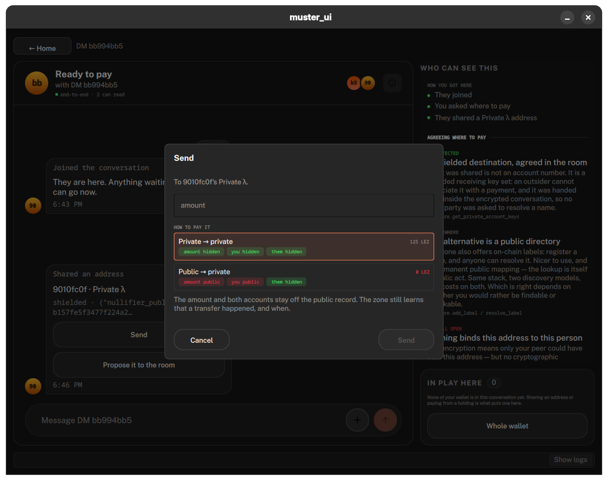
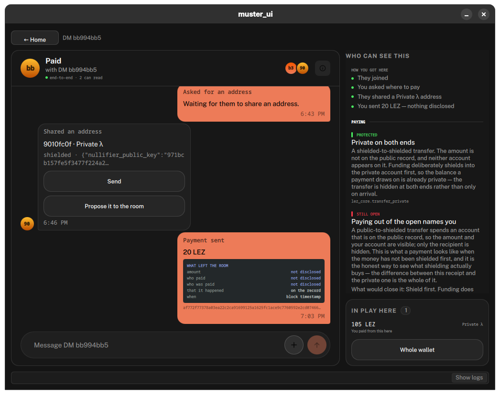

# Your History Is the Attack Surface: Quantum Computers, AI, and the Archive You're Building

*Draft. Status: Second Draft, restructured per the 2026-10-27 review with Jonny (holistic story, visceral example, PriFi framing, Ethereum vs Logos contrast, visuals). Not yet adversarially reviewed in this form. The in-depth, component-by-component analysis moved to the technical companion, [[quantum-and-ai-threats-technical-draft]], which is headed for the research forum. Open questions are collected at the bottom; resolve before publishing.*

---

Someone asked me recently what Logos is doing about quantum computers and AI. I sent them a [forum post](https://forum.research.logos.co/t/logos-techstack-pq-readiness/719) and two research-call recordings from our applied cryptography folks, which is a great answer if you enjoy an hour on proof sizes (I do, sue me (don't)). This is the version for everyone else, and it starts with somebody who has done everything right.

## Someone who did everything right

Picture someone with real money on-chain. A fund, a family office, a whale, pick your flavor. They've done the homework:

- Funds sit in a **3-of-5 Safe multisig**, five keyholders on five hardware wallets, so no single stolen device moves anything.
- Transactions go through a **private RPC**, so trades never hit the public mempool where bots can front-run them.
- Nobody posts addresses publicly. No ENS name, no doxxed wallet.
- Deals get talked through in a **private group chat** with partners, the way basically every crypto deal gets done.

That's more security than 99% of people will ever set up. Now watch what it leaves behind on one ordinary payment:

- **Creating the Safe** published its address, the five owner addresses, and who funded it. That's the org chart, public and permanent.
- **Proposing the payment** through the standard Safe interface put the full transaction (recipient, amount, timing) on the Safe Transaction Service, a public index, with a timestamp, *before anyone approved it*. The order and timing of each approval went up there too.
- **The private RPC** kept the trade out of the public mempool by handing the entire payload, signatures included, to one company that sees all of it in the clear.
- **Executing** published every signature. Every signer is recoverable from them, forever.
- **The group chat**, unless it's an end-to-end encrypted one, lives on the chat provider's servers.
- **Chain-analysis firms** pick it all up and fold it into the cluster they already keep on this Safe and every address that ever touched it.

None of that is a hack. Every one of those is a record that somebody else keeps. Put them together and you have an archive: who controls the money, who they deal with, what they intended to do before they did it, and the exact keys they sign with.

Institutions have it worse, because the archive *is* their org chart. A treasury multisig's owner set says who holds power; the timing of approvals says how decisions actually get made; a proposed trade sitting on a public index says what they're about to do. And when an institution gets hit, it's usually upstream of the chain: Bybit lost about $1.5 billion in 2025 because the signing interface was compromised. In the words of the [PriFi article](https://logos.co/media/article/pri-fi-securing-transaction-supply-chain), the chain "enforced what had been signed, not what was intended."

## Then it's you

The usual reaction to stories like this is "well, I'm not a whale. Who cares about me?"

That used to be a reasonable bet. Building a profile from an archive took analysts, time, and money, so it only got done to people worth the cost: the whales, the funds, the targets of physical "wrench attacks." The [first post in my transaction supply chain series](https://forum.research.logos.co/t/the-transaction-supply-chain-part-1-coming-together-with-an-intended-action/723) tallied over $100 million lost to physical-coercion attacks in the first four months of 2026 alone, and those start with somebody figuring out who holds what.

AI makes that cost roughly the same for everyone. Researchers at ETH Zurich [showed in 2024](https://arxiv.org/abs/2310.07298) that GPT-4 could infer location, income, and other personal attributes from people's Reddit posts at about 100x lower cost and 240x faster than humans. In February 2026, a team including Nicholas Carlini and Florian Tramèr [showed](https://arxiv.org/abs/2602.16800) LLM agents matching pseudonymous Hacker News accounts to their owners' real LinkedIn profiles at up to 68% recall with 90% precision. The best pre-LLM method got close to zero. Their conclusion: "practical obscurity protecting pseudonymous users online no longer holds."

So "who cares about me" is the wrong question. Nobody has to care about you. Profiling you costs about what it costs to profile the whale, and you have fewer of the whale's safeguards: probably one hot wallet, a public RPC, a username you reuse, and a group chat on someone else's server.

## Every leak is a deposit

The reason the archive exists at all is that a transaction is more than its settlement. The [PriFi framing](https://logos.co/media/article/pri-fi-securing-transaction-supply-chain) breaks a transaction into seven stages: **discovery** (finding who has what you want), **diligence** (checking they are who they claim), **negotiation**, **contracting**, **ordering** (whose transaction goes when), **settlement** (the only stage where value moves), and **enforcement**. Blockchains secure settlement, and they do it by publishing it. The PriFi article calls that the glass-vault problem: "a vault with exceptionally strong locks and perfectly transparent glass walls."

The other six stages run on infrastructure that logs everything: chat apps, explorers, indexers, RPC providers, transaction services. Every leak at every stage is a deposit into somebody's archive, and the archives are a business. Chain analytics is a [multi-billion-dollar industry](https://forum.research.logos.co/t/the-transaction-supply-chain-part-1-coming-together-with-an-intended-action/723) built on the transaction graph. The broader data broker market was valued at nearly $278 billion in 2024, per [Bathang's piece on metadata](https://logos.co/media/article/metadata-ai-inference). And a transaction is only as private as its leakiest stage: shield the settlement perfectly and the group chat where you agreed on the price already told someone everything.

Here's the whale's payment from above, next to the same payment done on Logos:

![[qa-archive-feed.png]]
*Figure 1. Same joint payment, two stacks. On the left, every stage feeds an archive somebody else keeps. On the right, the agreement stays in an end-to-end encrypted room, and what reaches the outside is "a transaction happened, at this time" plus metadata that's still being closed (more on that below).*

## How the archive gets read: AI and the mosaic

Bathang's [Metadata in the Age of AI Inference](https://logos.co/media/article/metadata-ai-inference), from February, lays out why the deposits add up. Metadata comes in three flavors: who (relationships), when (timing), and where (location). On its own, "a single piece of metadata rarely says much." Pieced together, it forms a mosaic. The classic example is a [2013 study](https://www.nature.com/articles/srep01376) of 1.5 million phone users: four rough location-and-time points were enough to single out 95% of them.

That article's argument was that AI automates the mosaic. Eight months later the evidence has only gotten stronger:

- **Pseudonyms:** the Hacker News result above landed two days after Bathang's piece was published.
- **Anonymity networks:** [MixMatch](https://petsymposium.org/popets/2024/popets-2024-0050.php) pointed deep-learning traffic analysis at the Nym mixnet. In the lab, after 100 observations, it matched about 60% of message flows at a 1% false-positive rate; on the live network, about 26%. Cover traffic (fake messages that look like real ones) substantially blunted older attacks. Mixnets help. They don't make you invisible.
- **Code:** AI is also reading the code you depend on. Anthropic's [SCONE-bench](https://www.anthropic.com/research/smart-contracts) had AI agents exploit about half of 405 real, previously exploited smart contracts in simulation, for about $1.22 to scan a fresh one. (Yes, that's a model vendor's benchmark.)

Bruce Schneier [called this in 2023](https://www.schneier.com/blog/archives/2023/12/ai-and-mass-spying.html): collection went bulk long ago, but *understanding* what was collected stayed limited by human labor. That limit is going away, and the archive it was protecting doesn't shrink.

## How the archive gets opened: quantum computers

AI reads what's in the archive. A quantum computer makes more of the archive readable, and it does two different things.

**It reads old encrypted data.** Most encryption today is set up with elliptic-curve key exchange, and a big enough quantum computer breaks that. Anyone who recorded the encrypted traffic can then read it, years later. This is called harvest-now-decrypt-later, and it's why Signal [added post-quantum encryption](https://signal.org/blog/pqxdh/) in 2023 and Apple [did the same for iMessage](https://security.apple.com/blog/imessage-pq3/) in 2024, before anyone has a machine that can do it. On a blockchain, nobody even has to do the recording: every node keeps a copy. Google's quantum team says the biggest quantum danger to Zcash is [retroactive loss of privacy](https://quantumai.google/static/site-assets/downloads/cryptocurrency-whitepaper.pdf), and that privacy can't be fully restored for data already on Zcash or Monero.

**It forges signatures.** Back to the whale. Every Safe execution published the signers' signatures, and from those, their public keys. A quantum computer turns a public key into the private key. Five hardware wallets, a 3-of-5 threshold, private RPC, no public addresses: none of it matters once three of those keys can be computed from the chain. Bitcoin has the same problem at scale: [Google's estimate](https://quantumai.google/static/site-assets/downloads/cryptocurrency-whitepaper.pdf) is about 6.7 million BTC sitting in addresses whose public keys are already exposed.

When? Nobody has the machine yet, but the estimates of what it takes keep dropping:

![[qa-qubit-estimates.png]]
*Figure 2. Published estimates of the physical qubits needed to break RSA-2048 and 256-bit elliptic curves (the kind blockchains use), against today's largest headline chips. Elliptic curves are the easier target. Different hardware types aren't directly comparable, so read the trend, not the exact gap.*

In March 2026, Google Quantum AI, with Justin Drake (Ethereum Foundation) and Dan Boneh (Stanford), estimated that the curve Bitcoin and Ethereum use falls to fewer than 500,000 physical qubits, about 9 minutes per key on the fastest kind of machine once it's warmed up. The 26 experts in the Global Risk Institute's [latest survey](https://globalriskinstitute.org/publication/quantum-threat-timeline-report-2025b/) rate a cryptographically relevant quantum computer within ten years as "quite possible" (28–49%) and within fifteen as "likely" (51–70%). Google [set 2029](https://blog.google/innovation-and-ai/technology/safety-security/cryptography-migration-timeline/) as its own migration deadline, and Cloudflare [moved to 2029](https://blog.cloudflare.com/post-quantum-roadmap) after the 2026 papers.

The two halves don't have the same deadline. Encryption breaks backward: decrypt once, read everything ever recorded. So the deadline for encryption is the day real data starts going out. Signatures mostly break forward: a forged signature only works while the network still accepts the old kind, so you can swap them out ahead of the machine. Once the old scheme is retired, a quantum attacker who can forge it holds a key to a door that's been bricked over. (Mostly. The technical companion covers the catches.)

Put the two weapons together and you get the 2037 version of the whale's story, or yours: quantum opens the encrypted parts of the archive, and AI puts names on everything inside it.

## Same payment, two stacks

So what does it look like to stop feeding the archive? I've been building a demo app on Logos called [Muster](https://github.com/corpetty/muster) (a personal project; disclaimer at the bottom) to answer exactly that, by doing the same action on different rails and recording what leaves the room at each stage. Here's the whale's joint payment three ways: (A) a Safe with the standard public Transaction Service, (B) a Safe where the signers coordinate privately among themselves, and (C) a private-to-private transfer on Logos testnet.

![[qa-rails-diff.png]]
*Figure 3. Per-stage "what left the room" for the same joint payment on three rails, from Muster's leak inventory (verified against the Safe 1.4.1 build). Rail B shows how much of the leak is a choice of coordination tool. Rail C shows what changes when settlement itself is private.*

A lot of the Ethereum leak is a choice of *tooling*: coordinating privately (rail B) keeps the negotiation out of a public index. But no amount of Ethereum tooling hides the *togetherness*: the owner set, the signers, the amount, and the parties all become public at execution on rails A and B, because that's how the chain verifies anything.

On Logos, the whole thing happens inside an end-to-end encrypted chat room, and the app tells you what each option discloses *before* you choose:

*Figure 4. Choosing how to pay in Muster. Private-to-private hides the amount and both parties; public-to-private leaves the amount and sender on the public record. The dialog says so before you click.*

And after the payment, it tells you what actually escaped:

*Figure 5. The receipt. "What left the room": amount, who paid, and who was paid, not disclosed. That it happened, and when, on the record.*

Same action, same feel, and the archive got "a transaction happened at this time" instead of the org chart.

Where the comparison has limits:

- **It's one variable.** Same action, same intent, different rail. The point isn't that Ethereum leaks (obviously) but *what* leaks, at which stage, to whom.
- **It's testnet.** The Logos side runs through a single testnet sequencer, which sees that a transaction arrived. That's disclosed in the app, and it's residual trust that has to shrink before anyone should rely on it.
- **Privacy costs time.** Generating the zero-knowledge proof for that private transfer took about seven minutes on my machine.
- **Some of the network layer isn't closed yet.** Logos Mix, which hides who's talking to whom at the network level, isn't wired end to end, so there's still peer-level metadata on the messaging network.
- **The agreement is still a human problem.** On every rail, *why* you signed lives outside any cryptographic hash. Muster shows you exactly what you're committing to; it can't make your counterparty honest.

## What Logos is doing about quantum

The archive defense only holds if the sealed parts stay sealed, which is where the quantum work comes in. The short version, per the team's August 2026 writeups (the [technical companion](https://logos-co.github.io/assembly/content-tracker/quantum-and-ai-threats-technical-draft) has the component-by-component detail):

- **Already done:** the encrypted account data that LEZ (Logos' execution layer for accounts and apps) posts on-chain uses ML-KEM-768, NIST's standardized post-quantum encryption, [merged in June 2026](https://github.com/logos-blockchain/logos-execution-zone/pull/474). Logos Chat, per our cryptographer Marvin Jones, uses a hybrid of classical and post-quantum encryption. The two encrypted pieces of the whale's payment, the transfer and the conversation, are covered.
- **Before mainnet:** post-quantum key exchange for connections between nodes (targeted for the end of 2026), and for Blend, the layer that hides which node produced a block.
- **After mainnet:** post-quantum signatures, then replacing the zero-knowledge proofs behind block production and wallet ownership. That last one is unsolved; the known replacements are tens to thousands of times bigger. Marvin's target for being fully post-quantum is 2030.

Logos wallet keys are designed so a quantum computer can't recover your secret from what's on-chain, so once the proofs are replaced, nobody's account is forfeited and nobody has to be online during a migration window. Until then, it's a race: if a quantum computer shows up before that last phase ships, Logos is in a worse spot than Bitcoin, and I'd rather say that here than have someone else say it for me. The reason the rest can wait is that it's forgery, not history. Nothing a future quantum computer forges reaches back and reads the archive.

## What you can do

You can't un-publish what's already in somebody's archive. You can stop adding to it, and that part is easier than it sounds.

- **Do the whole thing in one place.** Most leaks happen in the seams between tools: the chat app, the explorer, the transaction service, the RPC. [Basecamp](https://logos.co/basecamp) runs the Logos stack locally on your machine, and apps like Muster do discovery, negotiation, and payment in one encrypted room.
- **Stay private end to end.** The boundary between public and private accounts is where private-chain users usually get deanonymized ([Kappos et al., 2018](https://www.usenix.org/conference/usenixsecurity18/presentation/kappos)). Shield first, then pay, and don't cross back in ways that line up with what you say publicly.
- **Check what left the room.** If a tool can't tell you what it disclosed, assume the answer is "everything."
- **Use end-to-end encrypted, post-quantum messaging for anything sensitive** in the meantime. Signal already does this.

It's early, and the user-side protections are thinner than the network-side ones today. But the alternative is the default: every deal, every chat, every payment, quietly deposited into archives that only get easier to read.

## Methodology (holler at me)

I work at Logos, and the Logos-specific claims come from the team's own public material: Marvin's [forum post](https://forum.research.logos.co/t/logos-techstack-pq-readiness/719), two IFT research calls ([1](https://www.youtube.com/watch?v=M-hIwizTRE8), [2](https://www.youtube.com/watch?v=MeI52qWyVRs)), the Logos roadmap, and [docs.logos.co](https://docs.logos.co). The Ethereum vs Logos comparison comes from Muster's leak inventory, verified against the Safe 1.4.1 build. Muster is a personal project of mine, not a project of, affiliated with, or endorsed by Logos Collective Association or IFT Studio Pte. Ltd. External numbers link to primary sources. The [technical companion](https://logos-co.github.io/assembly/content-tracker/quantum-and-ai-threats-technical-draft) has the full component status, the open problems, and what I'm asking the team for. Thanks to a friend with a quantum computing background for checking the quantum section.

If you think I've got the threat model wrong, or that some part of this deserves more worry than I'm giving it, I want to hear it. Reply on the [forum thread](https://forum.research.logos.co/t/logos-techstack-pq-readiness/719) or hit me up on X.

*[Corey: AI-assistance acknowledgment line per voice profile.]*

---

## Open questions (strip before publishing)

1. **Quantum-section acknowledgement**: currently thanks "a friend with a quantum computing background"; swap in a name once Corey confirms he's OK being acknowledged.
2. **Muster screenshots** (`chat-send-dialogue.png`, `chat-txn-complete.png`) live in `content-tracker/muster-articles/`. Embedded by relative path (same as the Muster post does); confirm they render on the Pages site, or copy them into `content/attachments/`.
3. **Figure 1 is a composite.** The Ethereum side assumes a hosted (non-E2E) group chat and the standard Safe Transaction Service; the Safe stages are from the verified leak inventory. The Logos-side Ordering and Enforcement entries are "per design, confirm" in the inventory. Confirm before publishing.
4. **Chat X-Wing / MLS**: only Marvin's word; confirm it covers Chat's MLS group setup (see technical companion OQ12).
5. **"tens to thousands of times bigger" proofs**: 128-byte Groth16 vs kilobytes-to-hundreds-of-kilobytes STARKs. Confirm with the crypto team; soften to "much bigger" if needed.
6. **"Logos is in a worse spot than Bitcoin" if Q-day beats phase 3**: carried over from the reviewed technical draft; the crypto team should confirm the framing before it goes out under a Logos byline.
7. **Technical companion link**: points at the assembly Pages URL; swap for the forum URL once posted.
8. **Basecamp link**: Muster post uses logos.co/basecamp; PriFi article uses logos.co/get-started. Pick one.
9. **Carl's "be somewhat hyperbolic" note** vs Corey's "give people hope": the draft is vivid in the whale section and ends on practical steps. Corey's call whether to push harder.
10. All open questions in the technical companion still apply to the claims summarized here (docs.logos.co LEZ page still says ECDH; LEZ proof format; RLN; trapdoor framing).

## Sources consulted (strip before publishing)

- Meeting: Corey + Jonny, 2026-10-27 (petty-notes/meetings/mnemosyne).
- Logos: PriFi article (logos.co, 2026-09-15); Bathang, "Metadata in the Age of AI Inference" (logos.co, 2026-02-16); forum #719; IFT research calls; Muster posts and leak inventory (`muster-articles/intro-bucket-1.md`, `reference-safe-path-leak-inventory.md`, `contracting-supporting-material.md`); technical companion and its sources.
- Figures: `ideas/quantum-and-ai-threats-figures.py` renders `qa-archive-feed.png`, `qa-rails-diff.png`, `qa-qubit-estimates.png` into `content/attachments/`.
- Research notes: `logos-tech-writing/ideas/quantum-and-ai-threats-research/`; review trail for the technical companion: `ideas/quantum-and-ai-threats-draft-debate/`.
